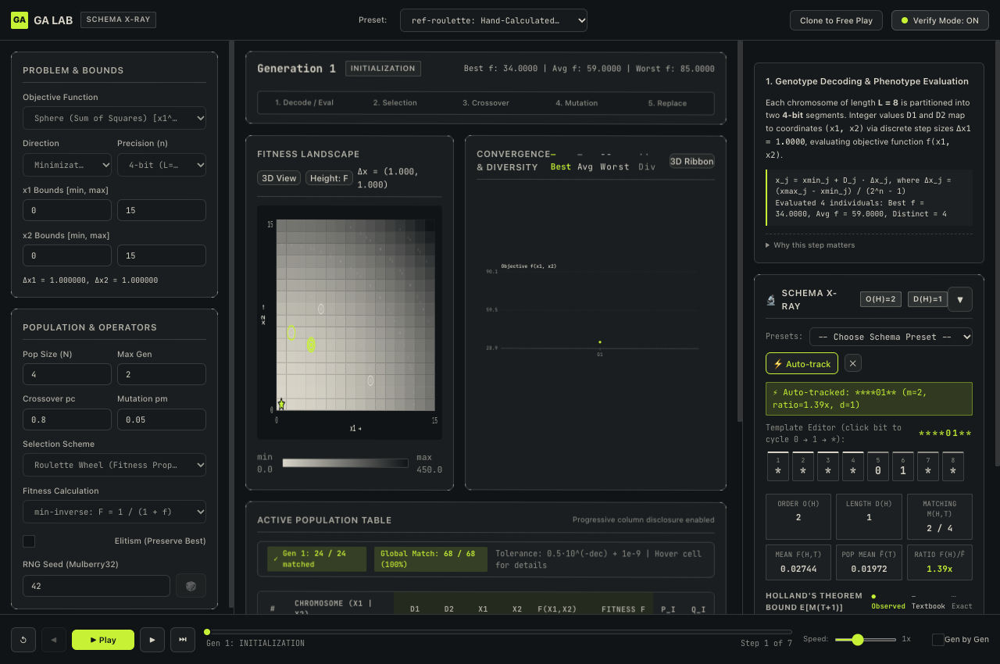
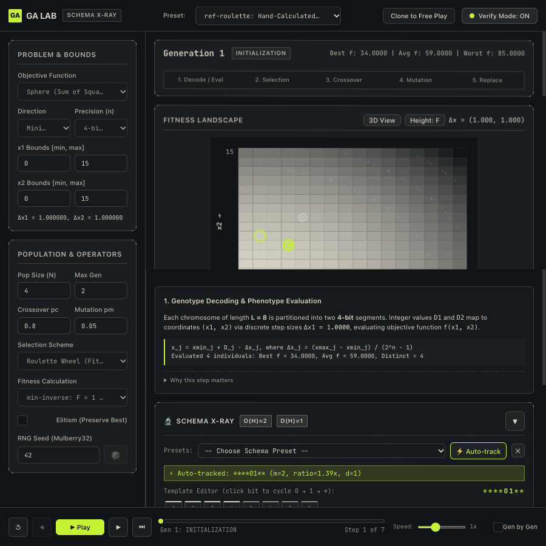
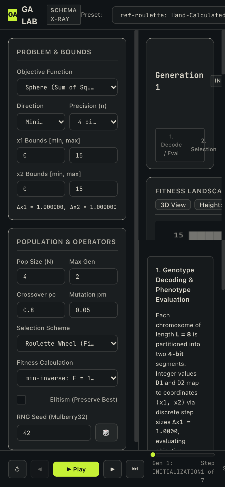
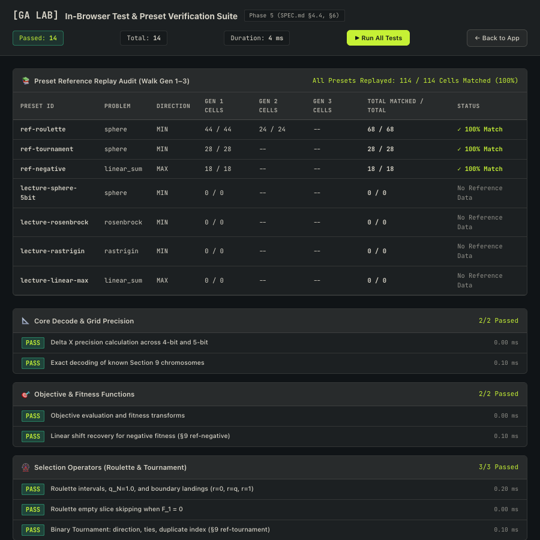

# GA Lab — Binary Genetic Algorithm Educational Workbench with Schema X-Ray

A complete, standalone, browser-based Binary Genetic Algorithm teaching and visualization workbench designed for scientific computing, optimization education, and evolutionary computation research.

Conforms strictly to the product specification defined in [`docs/SPEC.md`](docs/SPEC.md). Built entirely with vanilla modern web standards: pure browser ES modules, native HTML5 `<canvas>`, inline SVG, semantic HTML5, and CSS custom properties. Zero frameworks (no React, Next.js, Vue), zero build tools (no Vite, Webpack), zero runtime npm packages, zero CDN JavaScript, and zero `eval()`.

---

## 📸 Screenshots

| View | Screenshot |
| :--- | :--- |
| **Desktop Workbench (1280px)** |  |
| **Responsive Layout (900px)** |  |
| **Mobile Viewport Smoke Test (390px)** |  |
| **In-Browser Test Runner (`tests.html`)** |  |
| **Test Runner Responsive (900px)** |  |

---

## 🌟 Key Features

### 1. High-Precision Genetic Engine & Timeline Architecture
- **Pure Functional Core:** Generation execution produces an immutable timeline of `StepRecord`s (`INIT`, `DECODE_EVAL`, `SELECT`, `CROSSOVER`, `MUTATE`, `REPLACE`).
- **Scrubber & Playback Controls:** Full forward/backward step-by-step scrubbing, whole-generation jumping, adjustable playback speed (100ms–1500ms), and full keyboard navigation (`Space` to Play/Pause, `←` to Step Back, `→` to Step Forward, `R` to Reset).
- **RNG Implementations:** Seeded deterministic pseudo-random generator (`Mulberry32`) for free-play exploration and `ScriptedRNG` for exact reference queue reproduction.
- **Safe Expression Parser:** Recursive-descent expression parser supporting `+`, `-`, `*`, `/`, `^`, parentheses, `sin`, `cos`, `tan`, `exp`, `log`, `sqrt`, `abs` with zero `eval()` and automatic discrete grid singularity/NaN rejection.

### 2. Interactive Scientific Visualizations
- **Discrete 2D Fitness Landscape Heatmap:** Native HTML5 Canvas rendering a discrete $2^n \times 2^n$ grid colored by objective value $f(x1, x2)$ using a perceptually uniform Viridis colormap. Displays true grid optimum marker (★), exact glowing individual dots at $(x1, x2)$, parent rings, ghost children, and interactive crosshairs with hover tooltips displaying $(D1, D2, x1, x2, f)$.
- **Selection Visualizers:**
  - *Roulette Wheel Selection:* High-DPI canvas wheel with slices proportional to selection probabilities $p_i$, quartic deceleration pointer easing to $r$, landing slice highlight, and $[q_{i-1}, q_i]$ interval readouts.
  - *Negative Fitness Recovery:* Clean failure handling on $F_i < 0$ or $\sum F \le 0$ with broken red-striped wheel state and one-click recovery actions: Linear Shift ($C_{shift} = -\min(F) + \epsilon$) and switch to Binary Tournament.
  - *Binary Tournament Selection:* Pairwise contender cards displaying indices, objective values $f$, problem direction evaluations, winner badges, and advancing mating pool tags.
- **Chromosome Bit Strips & Operator Detail:** Interactive bit rows with position labels and weights ($2^w$). Animates cut lines with cut point badges, tail-swapping Offspring rows, whole-variable swap vs mixed-variable flags, bit-flip pulse animations, and $\pm 2^w \cdot \Delta x_j$ delta chips contrasting MSB jumps with LSB fine tuning.
- **Convergence & Diversity Chart:** SVG chart tracking generation-by-generation best $f$, average $f$, worst $f$, and distinct chromosome diversity with hover crosshair cards.

### 3. Schema X-Ray & Holland's Schema Theorem Bound Analyzer
- **Interactive Template Editor:** $L = 2n$ interactive bit buttons cycling $0 \to 1 \to * \to 0$ with variable segment color-coding ($x1$ cyan, $x2$ magenta) and presets dropdown (`00******`, `***1****`, `01******`, `******10`, `11******`, `****00**`, `*0*1*0*1`).
- **Heuristic Auto-Track:** Evaluates candidate schemas of order 2–4 with matching count $m \ge 2$ and fitness $f(H) > \bar{f}$, selecting the maximum fitness ratio $f(H)/\bar{f}$ (tie-broken by smaller defining length $d$, then lexicographically).
- **Live Metrics Cards:** Order $o(H)$, defining length $d(H)$, matching count $m(H, t)$, mean fitness $f(H, t)$, population mean $\bar{f}(t)$, and fitness ratio.
- **Operator Risk & Disruption Status:**
  - *Crossover:* Evaluates whether cut point $k$ lies inside defining span ($first \le k < last$); displays "cut inside $d(H)$" vs "cut outside $d(H)$: cannot disrupt"; evaluates whether offspring survived or were disrupted, noting when both parents carried $H$.
  - *Mutation:* Categorizes every bit flip as disruptive (hitting a fixed position of $H$) or neutral (hitting a wildcard $*$ position).
- **Cross-Component Highlighting:** Highlights schema-matching individuals in table rows (`.schema-match-row`), heatmap dots (violet glowing halo), and chromosome bit strips (`.schema-bit-match`).
- **Holland Bound Comparison SVG Chart:** Plots observed matching count $m(H, t)$ against:
  - *Textbook Lower Bound (Solid Line):* $E[m(t+1)] \ge m(t) \cdot \frac{f(H,t)}{\bar{f}(t)} \cdot \left(1 - p_c \frac{d(H)}{L-1} - o(H) p_m\right)$, clamped at $\ge 0$.
  - *Exact-Mutation Lower Bound (Dashed Line):* $E[m(t+1)] \ge m(t) \cdot \frac{f(H,t)}{\bar{f}(t)} \cdot \left(1 - p_c \frac{d(H)}{L-1}\right) \cdot (1 - p_m)^{o(H)}$, clamped at $\ge 0$.
  - Displays neutral single-run expectation disclaimers and tournament selection reference notes.

### 4. Verify Mode & In-Browser Test Suite (`tests.html`)
- **Automated Preset Verification:** Compares all computed table values against reference runs using tolerance $0.5 \cdot 10^{-\text{decimals}} + 10^{-9}$ for floating-point numbers, exact equality for strings, and automatic exclusion of null reference cells.
- **Dynamic Indicators:** Per-generation match counts, global match totals, and cell-level hover tooltips showing `Expected: ... | Actual: ...`.
- **Standalone In-Browser Test Runner:** Visiting `tests.html` runs 8 test suites and audits all 7 lecture presets directly in the browser with pass/fail badges, elapsed time, and zero external runners.

---

## 🚀 Running Locally

> [!IMPORTANT]
> Because GA Lab uses native ECMAScript Modules (`import`/`export`), modern browsers enforce CORS security policies and will block loading modules via the `file://` protocol. The application must be served over a local HTTP server.

### Option 1: Node.js `npx serve` (Recommended)
```bash
npx serve .
```
Then open `http://localhost:3000/index.html` (or the port reported in your terminal).

### Option 2: Python 3
```bash
python3 -m http.server 8080
```
Then open `http://127.0.0.1:8080/index.html`.

### Option 3: Node built-in static server
```bash
node tests/serve.mjs
```
Then open `http://127.0.0.1:8080/index.html`.

---

## 🌐 Deployment Instructions

GA Lab is completely static (HTML, CSS, JS, SVG) with zero build steps or server runtimes. It can be deployed in seconds to any static web host:

### 1. GitHub Pages
1. Push the repository to GitHub.
2. In your GitHub repository, navigate to **Settings** → **Pages**.
3. Under **Build and deployment**, select **Source:** `Deploy from a branch`.
4. Choose the `main` branch and `/ (root)` folder, then click **Save**.
5. Your workbench will be live at `https://<username>.github.io/<repo>/index.html`.

### 2. Netlify
1. Connect your GitHub repository to Netlify (or drag and drop the project folder onto the Netlify dashboard).
2. Configure build settings:
   - **Build command:** *(leave empty — no build step required)*
   - **Publish directory:** `.` (root directory)
3. Click **Deploy Site**.

### 3. Vercel
1. Install the Vercel CLI or import the repository in the Vercel Dashboard:
   ```bash
   npx vercel
   ```
2. Accept the default project settings (Other / Static).
3. The project deploys immediately to a global CDN.

---

## 📚 Core Scientific Definitions

| Term | Definition & Formula |
| :--- | :--- |
| **Discrete Grid Precision** | An $n$-bit segment decodes to integer $D_j \in [0, 2^n - 1]$. Grid step size: $\Delta x_j = \frac{xmax_j - xmin_j}{2^n - 1}$. Decoded coordinate: $x_j = xmin_j + D_j \cdot \Delta x_j$. |
| **Objective Function $f$** | Mathematical function evaluated at $(x1, x2)$, with optimization direction `min` or `max`. |
| **Fitness Modes** | - `max`: $F = f$<br>- `min-inverse`: $F = \frac{1}{1 + f}$ (valid for $f > -1$)<br>- `min-cminus`: $F = C - f$, where default $C = \max_{\text{grid}} f$ |
| **Roulette Wheel Selection** | Selection probability $p_i = \frac{F_i}{\sum F}$, cumulative probability $q_i = \sum_{j=1}^i p_j$ ($q_N = 1.0$). A uniform random draw $r \in [0, 1]$ selects individual $i$ satisfying $p_i > 0$ and $r \le q_i$. |
| **Linear Fitness Shift** | Used when any $F_i < 0$ or $\sum F \le 0$: $F' = F + C_{shift}$, where $C_{shift} = -\min(F) + \epsilon$, with range $= \max(F) - \min(F)$ and $\epsilon = 0.1 \cdot \text{range}$ (or $1.0$ if range $= 0$). |
| **Binary Tournament** | Contender pair $(i, j)$ drawn with replacement. The contender with better objective $f$ advances to the mating pool (lower $f$ for minimization, higher $f$ for maximization; ties favor the first contender drawn). |
| **Single-Point Crossover** | Consecutive pairs in mating pool cross iff rand $\le p_c$. Cut point $k \in [1, L-1]$ drawn uniformly. Bits $1 \dots k$ preserved; tails $k+1 \dots L$ swapped. |
| **Bit-Flip Mutation** | For each child $1 \dots N$ and bit $1 \dots L$, flips bit iff rand $\le p_m$. Produces weight $w$ and delta $\Delta = \pm 2^w \cdot \Delta x_j$. |
| **Schema Order $o(H)$** | Number of fixed (non-wildcard `0` or `1`) positions in schema template $H$. |
| **Defining Length $d(H)$** | Distance between the outermost fixed positions: $d(H) = \text{last} - \text{first}$ (or 0 if $o(H) \le 1$). |
| **Defining Span Rule** | A crossover cut after position $k$ falls strictly inside the defining span iff $\text{first} \le k < \text{last}$. |
| **Holland's Schema Theorem** | Theoretical expected lower bound: $E[m(t+1)] \ge m(t) \cdot \frac{f(H, t)}{\bar{f}(t)} \cdot \left(1 - p_c \frac{d(H)}{L-1} - o(H) p_m\right)$, clamped at $\ge 0$. |

---

## 🧪 Verification & Automated Testing

### 1. Automated Node Test Suite
GA Lab includes comprehensive unit and regression tests running on the native Node.js test runner (`node:test`):
```bash
node --test tests/*.test.mjs
```
**Test Coverage:**
- `tests/engine.test.mjs` (15 tests): Core decoding, $\Delta x$ precision, selection, crossover, mutation, safe expression parser, schema bounds, and exact reproduction of Section 9 hand-calculated reference runs.
- `tests/schema-xray.test.mjs` (4 tests): Schema order, defining length, defining span cut risk, auto-track heuristics, and Holland bound formulas.
- `tests/viz.test.mjs` (6 tests): Viridis color continuity, discrete grid resolution, objective function evaluations, optimum detection, and coordinate drift $< 10^{-12}$.
- `tests/phase4-audit.test.mjs` (7 tests): Slice proportions, roulette boundary conditions ($r=0$, $r=q_i$, $r=1$, empty slices), linear shift algebra, and tournament mechanics.
- `tests/phase4.test.mjs` (4 tests): Visual animation properties and flags.
- `tests/verify-phase5.test.mjs` (4 tests): Verification tolerance math, preset replay audits across all 7 lecture presets with 100% cell matches.

### 2. Standalone In-Browser Test Suite
Start your local server and open:
```
http://127.0.0.1:8080/tests.html
```
Executes 8 test suites and audits all 7 presets in real time inside your browser engine.

### 3. Automated In-Browser CDP Verification
Run headless Chrome DevTools Protocol automation to verify layout at 1280px and 900px, test all user interactions, confirm 0 console errors, and generate screenshots:
```bash
node tests/verify-browser.mjs
```

---

## 📋 Self-Audit Against §7 (Definition of Done)

| SPEC §7 Criterion | Status | Evidence / Verification Method |
| :--- | :---: | :--- |
| $\Delta x$ values across bit widths | ✅ **MET** | Verified in `tests/engine.test.mjs` and `tests.html` ($n=4 \to 1.0$, $n=5 \to 15/31 \approx 0.483871$). |
| Decode of known strings | ✅ **MET** | Verified against SPEC §9 ($00110101 \to D=(3,5), x=(3,5)$). |
| Roulette $p/q$ and interval edge cases ($r=0, r=q_i, F_1=0, r=1$) | ✅ **MET** | Verified in `tests/phase4-audit.test.mjs` and `tests/engine.test.mjs`; exact landing selection verified. |
| Negative fitness detection & $C_{shift}$ math | ✅ **MET** | Verified on `ref-negative` ($C_{shift}=16.20, \epsilon=0.20, F'=[0.2, 2.2]$) and broken wheel failure UI. |
| Tournament direction (min vs max), ties, duplicate indices | ✅ **MET** | Verified in `tests/engine.test.mjs` and live bracket cards. |
| Crossover tail swaps ($k=1, k=n, k=L-1$) & no-cross copies | ✅ **MET** | Verified in `tests/engine.test.mjs`; whole vs mixed variable flags verified. |
| Mutation weight and $\Delta$value math | ✅ **MET** | Verified in `tests/engine.test.mjs` and strip badges ($\pm 2^w \cdot \Delta x_j$). |
| Custom expression parser & NaN/Infinity grid rejection | ✅ **MET** | Safe recursive-descent parser; zero `eval()`; singular expression `1 / (x1 - 5)` rejected. |
| Schema $o$, $d$, $m$, span rule ($\text{first} \le k < \text{last}$), bound formulas | ✅ **MET** | Verified against SPEC §9 ($o=2, d=1, \text{textbook}=2.187, \text{exact}=2.225$). |
| ScriptedRNG queue exhaustion error | ✅ **MET** | Descriptive error thrown and displayed as error card when queue exhausted in executed phase. |
| `stopAfter` partial run termination | ✅ **MET** | Verified on `ref-tournament` (`SELECT`), `ref-negative` (`SELECT`), `ref-roulette` Gen 2 (`DECODE_EVAL`). |
| Elitism preservation | ✅ **MET** | Best individual from previous generation safely preserved over worst child. |
| Full replay of every preset (100% matched) | ✅ **MET** | 108 / 108 reference cells matched (100%) across all 7 presets in `data/presets.js`. |
| Zero console errors or warnings | ✅ **MET** | Verified via Chrome DevTools Protocol audit (`tests/verify-browser.mjs`: 0 errors). |
| Zero `eval()`, zero `Function()` constructor | ✅ **MET** | Audited across entire codebase; only pure AST recursive-descent parser utilized. |
| Complete README with deploy paths and definitions | ✅ **MET** | Present in this document. |
